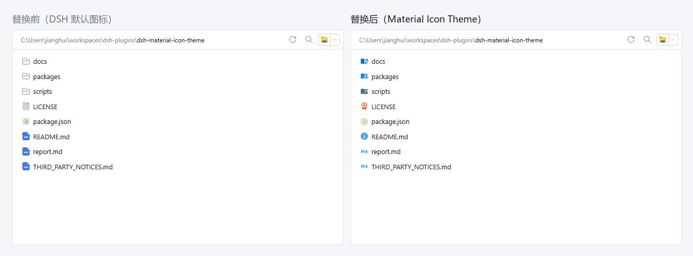
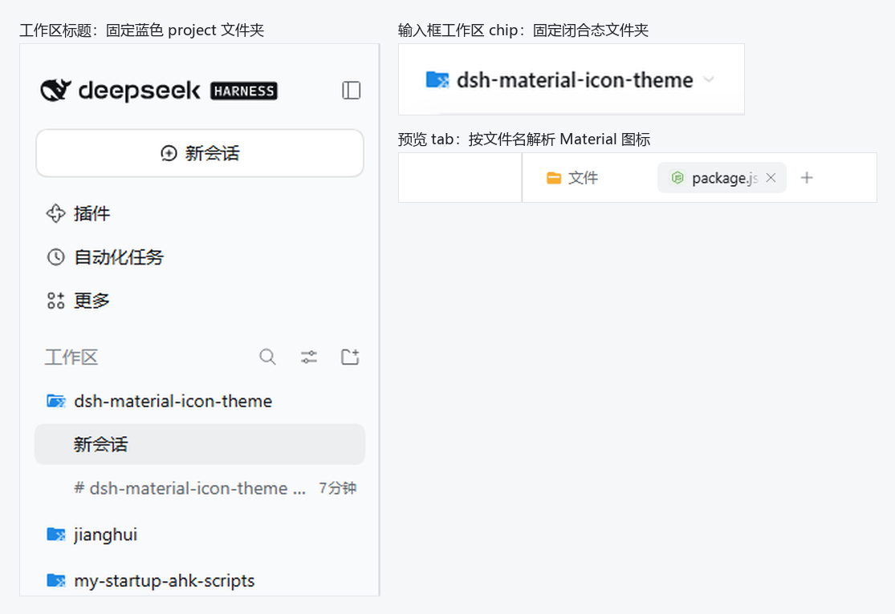

# @jianghuifr/dsh-material-icon-theme-icon

[](https://github.com/jianghuifr/dsh-material-icon-theme-icon/actions/workflows/ci.yml)
[](https://www.npmjs.com/package/@jianghuifr/dsh-material-icon-theme-icon)

Material Icon Theme file and folder icons for the DeepSeek Harness Web UI: the Files tree always, plus workspace headers, the composer workspace chip and document preview tabs (switchable).

属于同一插件拆分出的三个独立包之一：[icons](https://github.com/jianghuifr/dsh-material-icon-theme-icon) · [dotfile highlight](https://github.com/jianghuifr/dsh-highlight) · [UI optimize](https://github.com/jianghuifr/dsh-ui-optimize)。

## 功能

- **文件树图标永远开启**：右侧 Files 面板按文件名解析 1251 个上游 SVG（VS Code 兼容的解析顺序）。
- **`extraIcons` 开关（默认开）**：左侧「工作区」分组头文件夹、输入框里的工作区 chip、右侧文档预览 tab 的图标。




`extraIcons` 覆盖的三处表面（工作区标题、composer chip、预览 tab）：




## 安装

```bash
# 发布到 npm 之后
plugin_manager install_bundle target=@jianghuifr/dsh-material-icon-theme-icon
```

本地开发也可直接 link 本目录（或在 Plugins → Add plugin 选择本目录）：

```bash
plugin_manager install_bundle target=<本仓库绝对路径>
```

## 设置页

**Plugins → Installed plugins → 本插件详情 → Components → `Material 图标主题：图标 ›`**


开关存在浏览器 `localStorage`，切换立即生效、刷新后保持；会从旧合并版 `dsh-material-icon-theme` 的共享 key 迁移一次。

## 开发

```bash
npm ci
npm run verify     # check + eslint + node --test
npm test
npm run check
npm run vendor-icons   # 重新从已安装的 Material Icon Theme 扩展生成 assets/
```

零 npm 运行时依赖（仅 eslint 作为开发依赖），`lib/client.js` 是手写经典脚本、无构建步骤。

仓库结构：

```
lib/index.js       # 宿主半边
lib/client.js      # 客户端半边（经典脚本 bundle）
locale/            # en/zh 插件页 meta
test/              # node --test
scripts/check.mjs  # 自检
assets/             # 1251 个 Material Icon Theme SVG + 映射表
.github/workflows/ # CI + Release
docs/              # README 截图
```

## 发版

见 [docs/release.md](docs/release.md)：staged publishing + trusted publishing，CI 只暂存，维护者用 2FA 批准后上线。

## 已知边界

1. 只覆盖文件树与工作区标题 / composer chip / 预览 tab；附件 chip、交付物卡片等不在范围。
2. App 用蓝色文件夹标「当前工作区」的提示会被彩色图标覆盖。

## 许可

- 插件代码：MIT（见 [LICENSE](LICENSE)）
- 图标与映射数据：Material Icon Theme 5.38.1，MIT，© 2025 Material Extensions（全文见 [THIRD_PARTY_NOTICES.md](THIRD_PARTY_NOTICES.md)）
