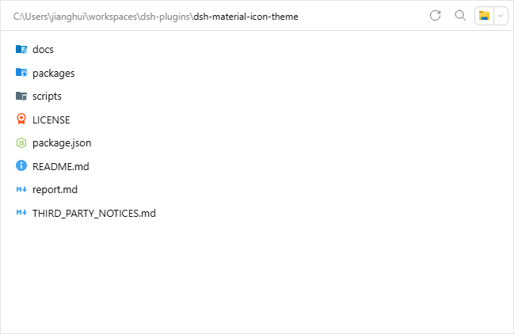
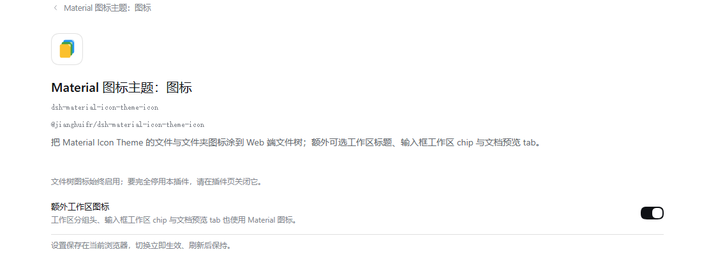

# @jianghuifr/dsh-material-icon-theme

[](https://github.com/jianghuifr/dsh-material-icon-theme/actions/workflows/ci.yml)
[](https://www.npmjs.com/package/@jianghuifr/dsh-material-icon-theme)

为 DeepSeek Harness Web UI 提供 Material Icon Theme 文件与文件夹图标：右侧文件树始终使用 Material 图标，并可选覆盖左侧工作区标题、输入框工作区 chip 和文档预览 tab。




`额外工作区图标` 覆盖的三处表面：


## 安装

```bash
plugin_manager install_bundle target=@jianghuifr/dsh-material-icon-theme
```

也可以用本地目录：`plugin_manager install_bundle target=<本目录绝对路径>`。

安装后在 **Plugins → 本插件详情 → Components → `Material 图标主题：图标 ›`** 打开配置：



- 文件树图标始终启用。
- `额外工作区图标`（默认开）：工作区标题、composer chip、预览 tab 使用 Material 图标；关闭后仅文件树保留图标。
- 设置保存在浏览器 localStorage，刷新后保持。

## 许可

MIT。图标素材来自 [Material Icon Theme](https://github.com/material-extensions/vscode-material-icon-theme) 5.38.1（MIT，© 2025 Material Extensions），全文见 [THIRD_PARTY_NOTICES.md](THIRD_PARTY_NOTICES.md)。
